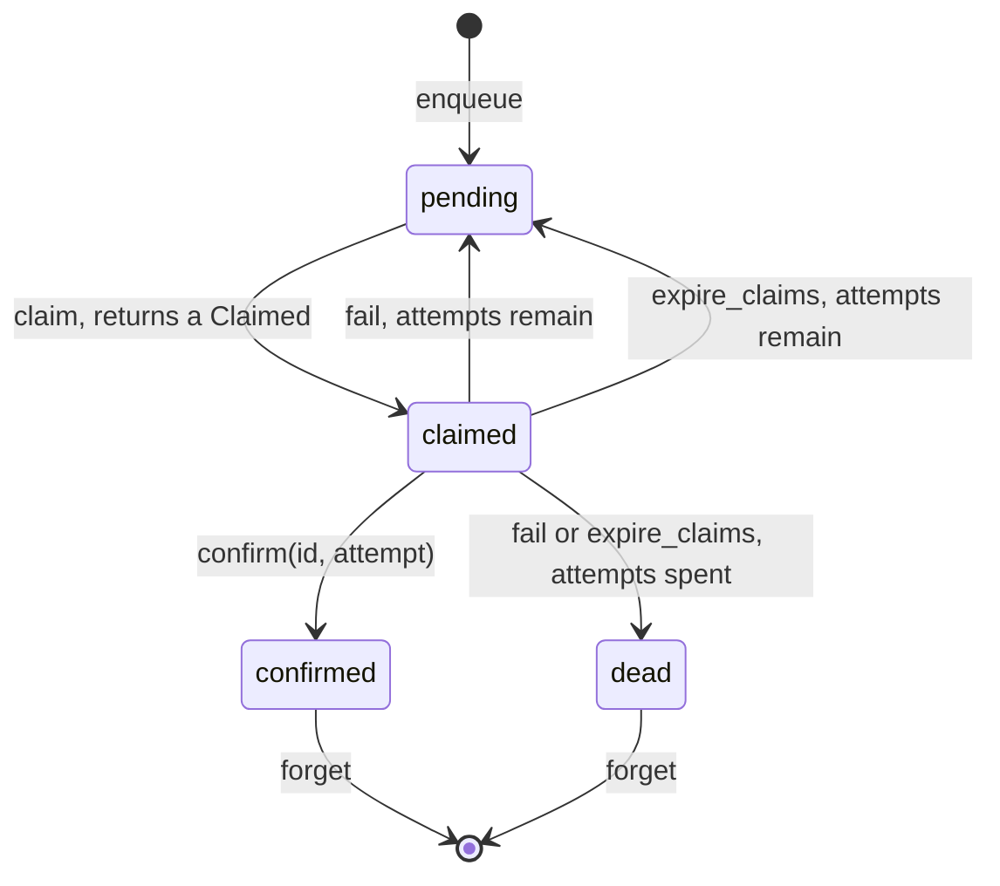
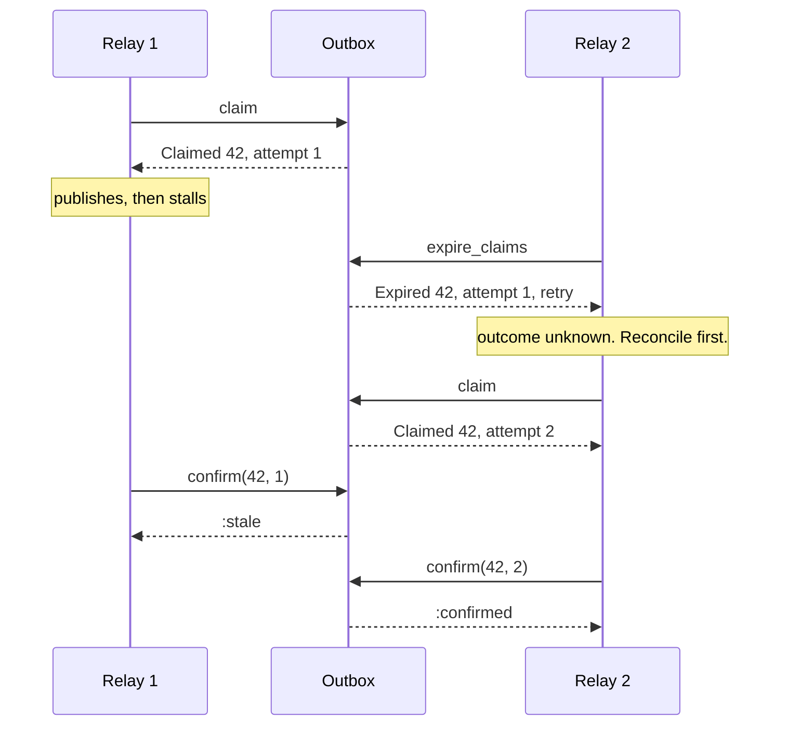

# OutboxMachines

> Sent, probably, is not a delivery status.

A delivery ledger for Ruby. Every message you owe the outside world gets a record: pending, claimed by one attempt, confirmed, or dead. Each claim carries an attempt number the outbox issues once and never again, so a worker that woke up late can't confirm or fail an attempt that has since been handed to someone else. Attempts that never report back are surfaced as what they are: unknown.

This is an initial release and the API is unstable. It is delivery policy, not a transactional outbox and not a retry engine: it does not write to your database, relay anything, sleep, or schedule.

## Quick Start

```bash
gem 'outbox_machines'
```

```ruby
SECOND = 1_000_000_000
def now = Process.clock_gettime(Process::CLOCK_MONOTONIC, :nanosecond)

outbox = OutboxMachines::Outbox.new(5)   # five attempts, then dead

# Once your transaction has committed the row:
outbox.enqueue(event.id, now)

def relay(outbox, broker)
  claimed = outbox.claim(now, 30 * SECOND)
  return unless claimed.is_a?(OutboxMachines::Claimed) # nil: nothing due

  broker.publish(payload_for(claimed.id))
  outbox.confirm(claimed.id, claimed.attempt)
rescue BrokerRefused
  outbox.fail(claimed.id, claimed.attempt, now, 5 * SECOND)
end
```

One outbox, six verbs. Ids and times are Integers. Every time, instant or span, in or out, is nanoseconds from a monotonic clock: `now`, `lease`, `retry_after`, a claim's `lease_expires`, the instant in a `Retry`.

The examples below use small numbers so the arithmetic fits on a line. They are nanoseconds like any other.

## A Message to the Resistance

So you saved the order and published `order.created` in the same request. The commit went through and the publish timed out. Or the publish went through and the commit rolled back. Either way, two systems now disagree about whether an order exists, and you find out from a customer.

You know what the docs told you to do. "Use the outbox pattern." So you add an `outbox` table and a relay loop. Then two relays pick up the same row. So you add a `locked_at` column. Then a relay dies holding the lock, so you add a timeout. Then the relay that wasn't dead, only slow, wakes up and marks the row sent, over the top of the retry that is halfway through sending it again.

The piece you keep rebuilding is a small state machine per message: waiting, out with one attempt, done, given up. With a number on each attempt, so yesterday's attempt can't speak for today's. And a deadline, after which the honest answer is "we don't know what happened". That machine is this gem.

## Chapter 1: Stardate 2026.316, the AMS Helland

> **AMS Helland**, NCC-4221, *Helland*-class dispatch courier.
> A dispatch with no receipt was neither delivered nor lost.

The courier doesn't carry the dispatches. It keeps the board. Every dispatch on it is waiting, out with a named runner, signed for, or written off. A runner who comes back after his run was given to someone else finds his chit is no longer good. The ship is named for Pat Helland, who spent a career explaining that the far side of a network is another country.

On a bridge somewhere, a cadet volunteers:

```ruby
def relay(row)
  broker.publish(row.payload)
  row.update!(sent: true)
rescue Timeout::Error
  retry
end
```

"That," says the courier's dispatcher, "is a timeout you have decided to read as a no."

## The Flight Plan

Each record the outbox holds is in one of these states:



And the afternoon a relay went quiet with message 42:



## How the Outbox Works

### Enqueue

```ruby
outbox = OutboxMachines::Outbox.new(3)   # max attempts

outbox.enqueue(42, 0)   # => :enqueued
outbox.enqueue(42, 0)   # => :duplicate
outbox.get(42)          # => #<data OutboxMachines::Entry id=42, state=:pending, attempts=0, attempt=nil, available_at=0>
outbox.get(7)           # => nil, no such record
```

`get(id)` answers the core's `Entry`: the record's `id`, its `state` (`:pending`, `:claimed`, `:confirmed` or `:dead`), the `attempts` claimed so far (what `max_attempts` counts), the `attempt` number of the latest one (`nil` until the first claim) and `available_at`, the earliest instant a pending record may be claimed. It answers `nil` for an id the outbox does not hold, and never refuses.

A record is an id and nothing else. The payload stays in your table. An id is taken for as long as its record exists, in any state.

`:duplicate` is not a refusal. You asked for the id to be on the board and it is, so the call is honoured and changes nothing, the outbox's clock included.

### Claim

```ruby
claimed = outbox.claim(0, 30_000)   # now 0, lease 30_000 ns
claimed   # => #<data OutboxMachines::Claimed id=42, attempt=1, lease_expires=30000>
outbox.claim(0, 30_000)             # => nil, nothing else is due
outbox.get(42).state                # => :claimed
```

`claim(now, lease)` hands out the due pending record that was enqueued first. `nil` means nothing is due, which is an answer and not a refusal. `attempt` is the identity of this attempt: the outbox numbers every claim it hands out from one sequence, starting at 1, and never uses a number twice. It is not the count of claims this record has had; that is `get(id).attempts`. `lease_expires` is `now + lease`, the instant from which `expire_claims` may reap the attempt. It is a deadline, not a timer: nothing happens when it passes until you ask.

### Fail

```ruby
failed = outbox.fail(42, claimed.attempt, 10, 5_000)
failed               # => #<data OutboxMachines::Failed disposition=#<data OutboxMachines::Retry at=5010>>
failed.disposition   # => #<data OutboxMachines::Retry at=5010>

# The reply got lost, so the relay reports the same attempt again:
outbox.fail(42, claimed.attempt, 12, 5_000)
# => #<data OutboxMachines::AlreadyFailed disposition=#<data OutboxMachines::Retry at=5010>>
outbox.fail(42, claimed.attempt, 12, 9_000)   # => :mismatch, that is not what was reported

outbox.claim(5_009, 30_000)                      # => nil, not due yet
second = outbox.claim(5_010, 30_000)
second.attempt                                   # => 2
outbox.fail(42, claimed.attempt, 5_010, 0)       # => :stale, attempt 1 was superseded
```

`fail(id, attempt, now, retry_after)` is for an attempt you know did nothing. You pass the delay, and the answer is a `Failed` wrapping the core's `Disposition`: a `Retry(at)` carrying the instant the record is claimable again, `now + retry_after`, or the symbol `:dead`. The outbox does not compute backoff.

Report the same attempt twice and the second answer is an `AlreadyFailed`. It is not a refusal: the attempt is over, as you asked, so the call is honoured and changes nothing, the clock included. Its disposition is the one from the first call. A repeat is the same report made again: same attempt, same `retry_after`. `now` is when you called, so it may differ, but a different `retry_after` is a different report and the answer is the refusal `:mismatch`, even for a record that died. The arguments of a repeat are still checked. The outbox honours that repeat only while it can prove it: until the record is claimed again, and only when it was `fail` that ended the attempt. An attempt reaped by `expire_claims` was never failed, so a `fail` for it is `:stale`.

Once the attempts are spent the answer changes:

```ruby
single = OutboxMachines::Outbox.new(1)
single.enqueue(1, 0)
only = single.claim(0, 10)

single.fail(1, only.attempt, 5, 1_000)   # => #<data OutboxMachines::Failed disposition=:dead>
single.fail(1, only.attempt, 6, 1_000)   # => #<data OutboxMachines::AlreadyFailed disposition=:dead>
single.get(1).state                      # => :dead
single.claim(10_000, 10)                 # => nil
```

A dead record is never claimed again. It sits there, countable with `count(:dead)`, until you `forget` it.

### Confirm

```ruby
outbox.confirm(42, 1)   # => :stale, attempt 1 was superseded
outbox.confirm(42, 2)   # => :confirmed
outbox.confirm(42, 2)   # => :already_confirmed, and nothing changed
outbox.confirm(42, 1)   # => :stale, still not the attempt that confirmed
outbox.confirm(7, 1)    # => :unknown
```

`confirm` is your word that the effect is persisted on the other side. The outbox can't check. Call it after the broker's acknowledgement or your durable write, never before.

`:already_confirmed` is not a refusal. A confirmed record is never claimed again, so its latest attempt is the one that confirmed it, and the outbox can tell that attempt's repeat from anyone else's for as long as it holds the record. After `forget` the record and the proof are both gone, and the same call answers `:unknown`.

### Expire claims

```ruby
outbox = OutboxMachines::Outbox.new(2)
outbox.enqueue(1, 0)
lost = outbox.claim(0, 10)

sweep = outbox.expire_claims(9, 64)
sweep.expired                  # => []
sweep.scanned                  # => 64
sweep.complete                 # => true

sweep = outbox.expire_claims(10, 64)
sweep.expired                  # => [#<data OutboxMachines::Expired id=1, attempt=1, disposition=#<data OutboxMachines::Retry at=10>>]
outbox.get(1).state            # => :pending

fresh = outbox.claim(10, 10)
fresh.attempt                  # => 2
outbox.confirm(1, lost.attempt)    # => :stale
outbox.confirm(1, fresh.attempt)   # => :confirmed
```

`expire_claims(now, max_scan)` reaps claims whose lease has ended and answers a `Sweep`: `expired`, `scanned` and `complete`. Each entry of `expired` is an `Expired` with an `id`, an `attempt` and a `disposition`, which is a `Retry(at)` or `:dead`. An expired record is due again immediately, so `at` is the `now` you passed. One call looks at no more than `max_scan` slots, says how many it looked at in `scanned`, and reaps no more than 16 claims. Keep calling until `complete` is true.

An expired attempt did not fail. Nobody knows what it did. Until it is reaped, a late `confirm` for it is still accepted, because if the effect happened the record must not go out again.

### Forget

```ruby
outbox.enqueue(1, 10)   # => :duplicate, confirmed records keep their id
outbox.forget(1)        # => :forgotten
outbox.forget(1)        # => :not_held
outbox.enqueue(1, 10)   # => :enqueued
outbox.forget(1)        # => :not_terminal
```

Only confirmed and dead records can be forgotten. Forgetting frees the slot and the id. `:not_held` is not a refusal: you asked for the record to be gone and it is, whether it was forgotten earlier or never enqueued.

Forgetting does not free the attempt numbers the record used. Enqueue the id again and it is a new record whose first claim gets a number nobody has held:

```ruby
outbox = OutboxMachines::Outbox.new(3)
outbox.enqueue(7, 0)
old = outbox.claim(0, 10)             # attempt 1
outbox.confirm(7, old.attempt)        # => :confirmed
outbox.forget(7)                      # => :forgotten
outbox.enqueue(7, 0)                  # => :enqueued, a new record
fresh = outbox.claim(0, 10)
fresh.attempt                         # => 2
outbox.get(7).attempts                # => 1
outbox.confirm(7, old.attempt)        # => :stale, a report about the record that is gone
outbox.fail(7, old.attempt, 0, 0)     # => :stale
```

### Capacity

The outbox holds 64 records at a time, in any state. Past that, `enqueue` refuses with `:full` until something is forgotten:

```ruby
outbox = OutboxMachines::Outbox.new(3)
outbox.capacity               # => 64
OutboxMachines::CAPACITY      # => 64
outbox.max_attempts           # => 3

64.times { |i| outbox.enqueue(i, 0) }
outbox.enqueue(64, 0)         # => :full
outbox.size                   # => 64
outbox.count(:pending)        # => 64
```

Nothing is ever evicted to make room, confirmed and dead records included. Forget what you have dealt with.

### Time only moves forward

The outbox remembers the latest time it has seen. Hand it an earlier one and it refuses:

```ruby
outbox = OutboxMachines::Outbox.new(3)
outbox.enqueue(1, 10)         # => :enqueued
outbox.enqueue(2, 9)          # => :time_regression
outbox.claim(9, 5)            # => :time_regression
outbox.expire_claims(9, 1)    # => :time_regression
outbox.claim(10, 0)           # => :invalid_duration
```

A zero lease is `:invalid_duration`. Feed it `Process.clock_gettime(Process::CLOCK_MONOTONIC, :nanosecond)`, never wall-clock time.

Only a call that is honoured and takes effect moves that clock. A refusal doesn't, and neither does a repeat: a `:duplicate` enqueue or an `AlreadyFailed`. (`confirm` and `forget` take no time at all.) A `claim` that finds nothing due and an `expire_claims` that reaps nothing were both honoured, so the time they were given counts.

### What each verb can answer

| Verb | Honoured | Refusals |
| --- | --- | --- |
| `enqueue` | `:enqueued`, `:duplicate` | `:time_regression`, `:full`, `:exhausted` |
| `claim` | a `Claimed`, `nil` | `:time_regression`, `:invalid_duration`, `:exhausted` |
| `confirm` | `:confirmed`, `:already_confirmed` | `:unknown`, `:stale` |
| `fail` | `Failed(disposition)`, `AlreadyFailed(disposition)` | `:unknown`, `:stale`, `:time_regression`, `:invalid_duration`, `:mismatch` |
| `expire_claims` | a `Sweep` | `:time_regression` |
| `forget` | `:forgotten`, `:not_held` | `:not_terminal` |

A `disposition` is a `Retry(at)` or `:dead`. The queries `get`, `count`, `size`, `empty?`, `capacity` and `max_attempts` never refuse.

`:duplicate`, `:already_confirmed`, `AlreadyFailed` and `:not_held` are idempotent repeats: what you asked for already holds, so the call is honoured and changes nothing.

`:unknown` comes from `confirm` and `fail` only, for an id the outbox does not hold. That includes a record you have since forgotten: the outbox keeps nothing about it, so it cannot call your report a repeat. `:stale` means the id is held but the attempt is neither its live one nor the one whose outcome the call repeats; an attempt that belonged to an earlier record with the same id is exactly that. `:mismatch` comes from `fail` only: the attempt was already failed, with a different `retry_after`.

`:exhausted` means the outbox has admitted 2**64 records, or handed out 2**64 claims, in its lifetime. It cannot be reached from Ruby in practice; you will not see it. Each refusal is the snake_case of one core `Refusal` variant; there is no catch-all symbol.

## The Rules of the Courier

- **Ids and times are Integers** in `0..2**64-1`. Floats, nil, and strings raise `TypeError`. Negative or past `2**64-1` raises `RangeError`, and so does a `max_attempts` outside `1..2**32-1`.
- **Time is Integer nanoseconds**, for instants and spans alike. No floats, no milliseconds, no `Time`. An instant the outbox answers is exact, so `now + lease` can exceed `2**64-1` when you feed it numbers that large.
- **A Claimed is an id, an attempt, and `lease_expires`.** `Claimed`, `Expired`, `Sweep` and `Entry` are plain frozen `Data` values with the fields of the core structs they are named after; `Retry` is the core's `Disposition::Retry(at)`, and `Failed` and `AlreadyFailed` are the two variants of its `Failure`. `Sweep#expired` holds the reaped claims themselves where the core's `Sweep::written` counts the entries it wrote to the caller's buffer. `confirm` and `fail` take the first two numbers of a `Claimed`, and an attempt that is neither the live one nor the one being repeated is `:stale`. Attempt numbers are never reissued, so a `Claimed` from last week cannot speak for a record enqueued today.
- **Refusals don't raise.** `:full`, `:stale`, `:unknown`, `:not_terminal`, `:time_regression`, `:invalid_duration`, `:exhausted` and `:mismatch` are answers. Only malformed input raises. A refused call changes nothing: no record, and not the clock.
- **Repeats are honoured.** `:duplicate`, `:already_confirmed`, `AlreadyFailed` and `:not_held` say the effect you asked for already holds. They change nothing either.
- **Lookup is a scan.** The table is small on purpose. Shard across outboxes before you ask for a bigger one.
- **Frozen means frozen.** `freeze` the outbox and `enqueue`, `claim`, `confirm`, `fail`, `expire_claims`, and `forget` all raise `FrozenError`. Reads still work.
- **Native is required.** There is no pure-Ruby fallback.

## What You Think You're Doing vs Reality

### You Think: "The lease expired, so the send failed. Retry."
### Reality: The send might be sitting in the broker right now.

A timeout tells you the worker stopped talking. It doesn't tell you what the worker did first. That's why expiry and failure are separate verbs here: `fail` is a fact you supply, `expire_claims` is a list of questions the outbox hands back. Answer them, with an idempotency key on the destination, a fence, or a lookup, before the next attempt goes out.

## What's Yours

The outbox lives in your process and forgets everything when the process does. Writing the outbox row in the same transaction as the business change is yours. So is the durable record of who claimed what, rebuilding the table after a restart, the relay loop, the backoff schedule, and working out what an expired attempt actually did. Receiving is a different problem: deduplicating what arrives is [dedup_machines](https://github.com/seuros/dedup_machines). This gem shares no code with it, or with the lease, chrono, and saga gems. They meet in your adapter.

## License

MIT License. See [LICENSE.txt](LICENSE.txt) for details.

**Remember: the relay will time out. The question is whether you call that a failure.**
