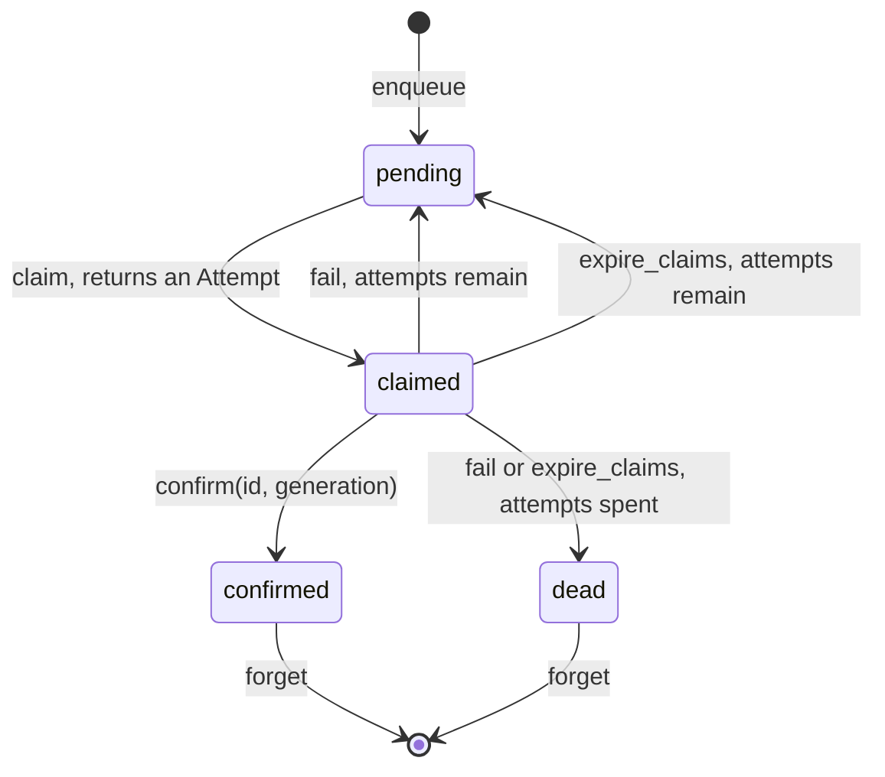
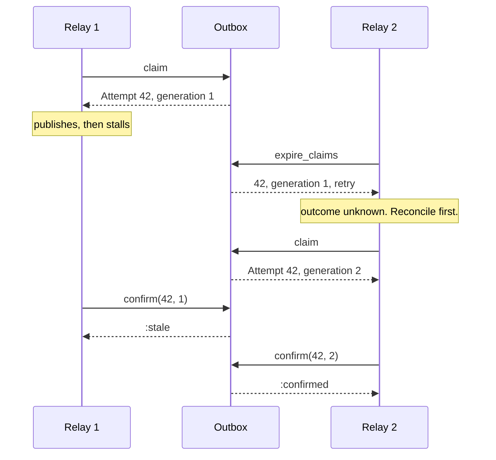

# OutboxMachines

> Sent, probably, is not a delivery status.

A delivery ledger for Ruby. Every message you owe the outside world gets a record: pending, claimed by one attempt, confirmed, or dead. Each claim carries a generation, so a worker that woke up late can't confirm or fail an attempt that has since been handed to someone else. Attempts that never report back are surfaced as what they are: unknown.

This is an initial release and the API is unstable. It is delivery policy, not a transactional outbox and not a retry engine: it does not write to your database, relay anything, sleep, or schedule.

## Quick Start

```bash
gem 'outbox_machines'
```

```ruby
outbox = OutboxMachines::Outbox.new(5)   # five attempts, then dead

# Once your transaction has committed the row:
outbox.enqueue(event.id, clock.now_ms)

def relay(outbox, clock, broker)
  attempt = outbox.claim(clock.now_ms, 30_000)
  return unless attempt.is_a?(OutboxMachines::Attempt) # nil: nothing due

  broker.publish(payload_for(attempt.id))
  outbox.confirm(attempt.id, attempt.generation)
rescue BrokerRefused
  outbox.fail(attempt.id, attempt.generation, clock.now_ms, 5_000)
end
```

One outbox, six verbs. Ids and times are Integers. Times are milliseconds from a clock that only goes forward.

## A Message to the Resistance

So you saved the order and published `order.created` in the same request. The commit went through and the publish timed out. Or the publish went through and the commit rolled back. Either way, two systems now disagree about whether an order exists, and you find out from a customer.

You know what the docs told you to do. "Use the outbox pattern." So you add an `outbox` table and a relay loop. Then two relays pick up the same row. So you add a `locked_at` column. Then a relay dies holding the lock, so you add a timeout. Then the relay that wasn't dead, only slow, wakes up and marks the row sent, over the top of the retry that is halfway through sending it again.

The piece you keep rebuilding is a small state machine per message: waiting, out with one attempt, done, given up. With a number on each attempt, so yesterday's attempt can't speak for today's. And a deadline, after which the honest answer is "we don't know what happened". That machine is this gem.

## Chapter 1: Stardate 2026.316, the AMS Helland

> **AMS Helland**, NCC-4221, *Helland*-class dispatch courier.
> A dispatch with no receipt was neither delivered nor lost.

The courier doesn't carry the dispatches. It keeps the board. Every dispatch on it is waiting, out with a named runner, signed for, or written off. A runner who comes back after his run was given to someone else finds his chit is no longer good. The ship is named for Pat Helland, who spent a career explaining that the far side of a network is another country.

On a bridge somewhere, a cadet volunteers:

```ruby
def relay(row)
  broker.publish(row.payload)
  row.update!(sent: true)
rescue Timeout::Error
  retry
end
```

"That," says the courier's dispatcher, "is a timeout you have decided to read as a no."

## The Flight Plan

Each record the outbox holds is in one of these states:



And the afternoon a relay went quiet with message 42:



## How the Outbox Works

### Enqueue

```ruby
outbox = OutboxMachines::Outbox.new(3)   # max attempts

outbox.enqueue(42, 0)   # => :enqueued
outbox.enqueue(42, 0)   # => :duplicate
outbox.state(42)        # => :pending
```

A record is an id and nothing else. The payload stays in your table. An id is taken for as long as its record exists, in any state.

### Claim

```ruby
attempt = outbox.claim(0, 30_000)   # now 0 ms, lease 30 s
attempt                             # => #<data OutboxMachines::Attempt id=42, generation=1>
outbox.claim(0, 30_000)             # => nil, nothing else is due
outbox.state(42)                    # => :claimed
```

`claim` hands out the due pending record that was enqueued first. The generation is the count of claims this record has had, starting at 1. The lease is a deadline for `expire_claims`, not a timer: nothing happens when it passes until you ask.

### Fail

```ruby
outbox.fail(42, attempt.generation, 10, 5_000)   # => [:retry, 5010]
outbox.claim(5_009, 30_000)                      # => nil, not due yet
retry_attempt = outbox.claim(5_010, 30_000)
retry_attempt.generation                         # => 2
```

`fail` is for an attempt you know did nothing. You pass the delay. The outbox does not compute backoff. Once the attempts are spent the answer changes:

```ruby
single = OutboxMachines::Outbox.new(1)
single.enqueue(1, 0)
only = single.claim(0, 10)

single.fail(1, only.generation, 5, 1_000)   # => :dead
single.state(1)                             # => :dead
single.claim(10_000, 10)                    # => nil
```

A dead record is never claimed again. It sits there, countable with `count(:dead)`, until you `forget` it.

### Confirm

```ruby
outbox.confirm(42, 1)   # => :stale, generation 1 was superseded
outbox.confirm(42, 2)   # => :confirmed
outbox.confirm(42, 2)   # => :stale, it isn't claimed any more
outbox.confirm(7, 1)    # => :unknown
```

`confirm` is your word that the effect is persisted on the other side. The outbox can't check. Call it after the broker's acknowledgement or your durable write, never before.

### Expire claims

```ruby
outbox = OutboxMachines::Outbox.new(2)
outbox.enqueue(1, 0)
lost = outbox.claim(0, 10)

outbox.expire_claims(9, 64)    # => [[], true]
outbox.expire_claims(10, 64)   # => [[[1, 1, [:retry, 10]]], true]
outbox.state(1)                # => :pending

fresh = outbox.claim(10, 10)
fresh.generation               # => 2
outbox.confirm(1, lost.generation)    # => :stale
outbox.confirm(1, fresh.generation)   # => :confirmed
```

`expire_claims(now_ms, max_scan)` reaps claims whose lease has ended and returns `[rows, complete]`. Each row is `[id, generation, disposition]`, and the disposition is `[:retry, at_ms]` or `:dead`. One call looks at no more than `max_scan` records and returns no more than 16 rows. Keep calling until `complete` is true.

An expired attempt did not fail. Nobody knows what it did. Until it is reaped, a late `confirm` for it is still accepted, because if the effect happened the record must not go out again.

### Forget

```ruby
outbox.enqueue(1, 10)   # => :duplicate, confirmed records keep their id
outbox.forget(1)        # => :forgotten
outbox.forget(1)        # => :unknown
outbox.enqueue(1, 10)   # => :enqueued
outbox.forget(1)        # => :not_terminal
```

Only confirmed and dead records can be forgotten. Forgetting frees the slot and the id.

### Capacity

The outbox holds 64 records at a time, in any state. Past that, `enqueue` says `:full` until something is forgotten:

```ruby
outbox = OutboxMachines::Outbox.new(3)
outbox.capacity               # => 64
OutboxMachines::CAPACITY      # => 64
outbox.max_attempts           # => 3

64.times { |i| outbox.enqueue(i, 0) }
outbox.enqueue(64, 0)         # => :full
outbox.size                   # => 64
outbox.count(:pending)        # => 64
```

Nothing is ever evicted to make room, confirmed and dead records included. Forget what you have dealt with.

### Time only moves forward

The outbox remembers the latest time it has seen. Hand it an earlier one and it refuses:

```ruby
outbox = OutboxMachines::Outbox.new(3)
outbox.enqueue(1, 10)         # => :enqueued
outbox.enqueue(2, 9)          # => :time_regression
outbox.claim(9, 5)            # => :time_regression
outbox.expire_claims(9, 1)    # => :time_regression
outbox.claim(10, 0)           # => :invalid_duration
```

A zero lease is `:invalid_duration`. Feed it a monotonic clock in milliseconds.

## The Rules of the Courier

- **Ids and times are Integers** in `0..2**64-1`. Times are milliseconds. Floats, nil, and strings raise `TypeError`. Out of range raises `RangeError`, and so does a `max_attempts` outside `1..2**32-1`.
- **An Attempt is an id and a generation.** It is a plain frozen `Data` value. `confirm` and `fail` take the two numbers, and a generation that isn't the live one is `:stale`.
- **Refusals don't raise.** `:duplicate`, `:full`, `:stale`, `:unknown`, `:not_terminal`, `:time_regression`, `:invalid_duration`, `:exhausted`, and `nil` are answers. Only malformed input raises. A refused call leaves every record as it was.
- **Lookup is a scan.** The table is small on purpose. Shard across outboxes before you ask for a bigger one.
- **Frozen means frozen.** `freeze` the outbox and `enqueue`, `claim`, `confirm`, `fail`, `expire_claims`, and `forget` all raise `FrozenError`. Reads still work.
- **Native is required.** There is no pure-Ruby fallback.

## What You Think You're Doing vs Reality

### You Think: "The lease expired, so the send failed. Retry."
### Reality: The send might be sitting in the broker right now.

A timeout tells you the worker stopped talking. It doesn't tell you what the worker did first. That's why expiry and failure are separate verbs here: `fail` is a fact you supply, `expire_claims` is a list of questions the outbox hands back. Answer them, with an idempotency key on the destination, a fence, or a lookup, before the next attempt goes out.

## What's Yours

The outbox lives in your process and forgets everything when the process does. Writing the outbox row in the same transaction as the business change is yours. So is the durable record of who claimed what, rebuilding the table after a restart, the relay loop, the backoff schedule, and working out what an expired attempt actually did. Receiving is a different problem: deduplicating what arrives is [dedup_machines](https://github.com/seuros/dedup_machines). This gem shares no code with it, or with the lease, chrono, and saga gems. They meet in your adapter.

## License

MIT License. See [LICENSE.txt](LICENSE.txt) for details.

**Remember: the relay will time out. The question is whether you call that a failure.**
